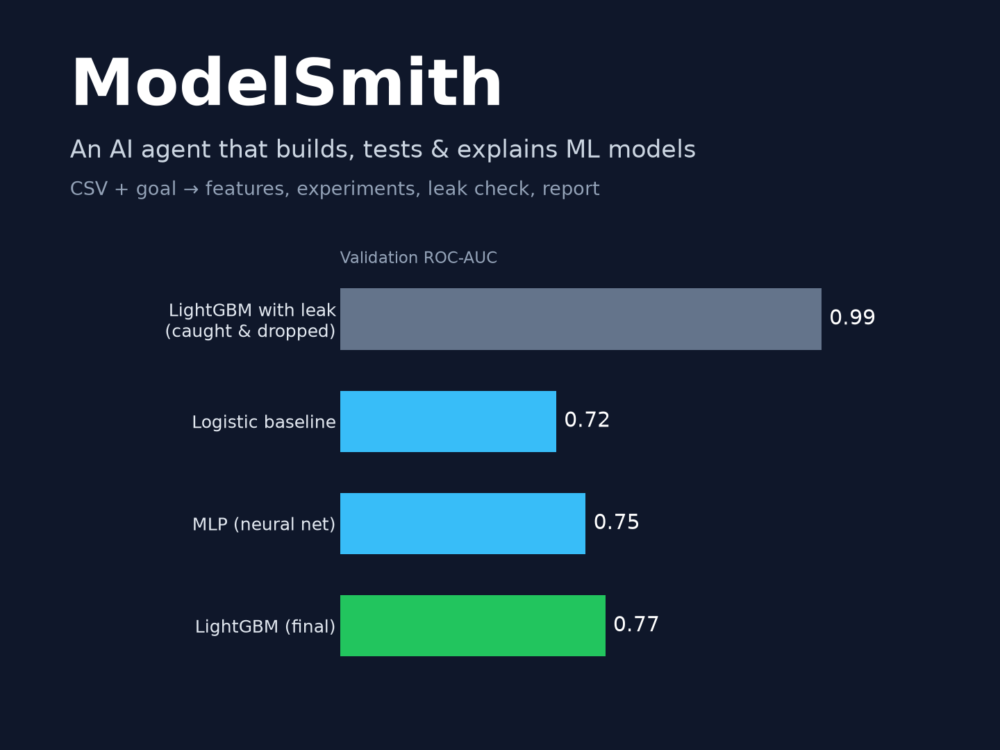
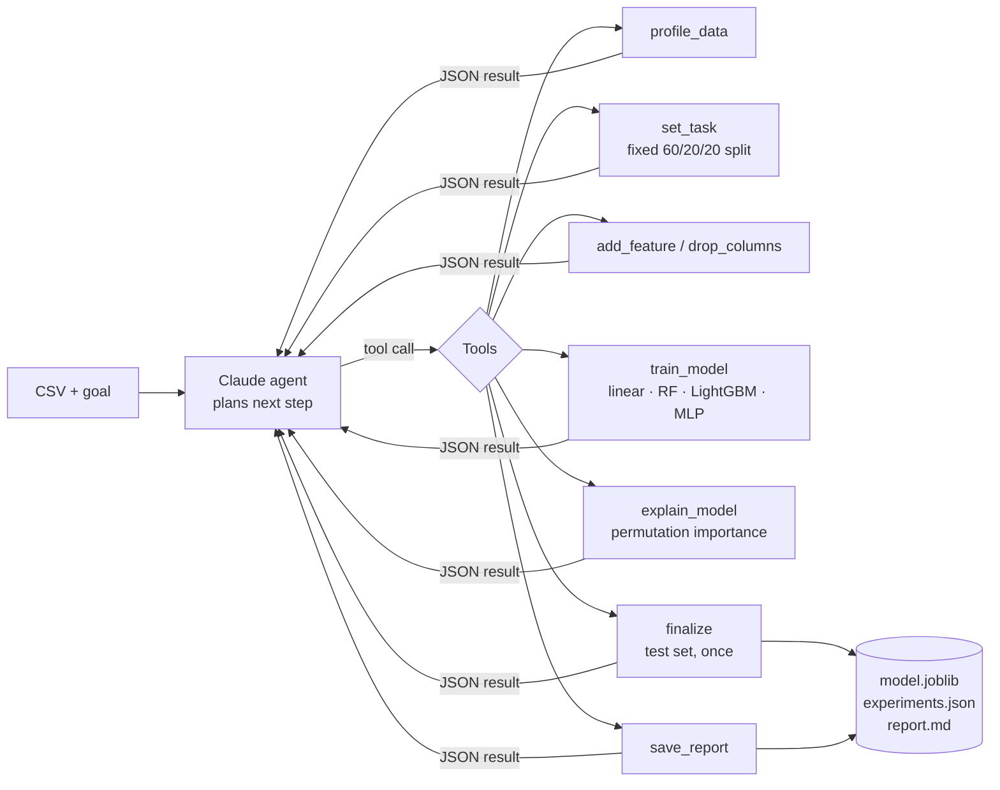

# ModelSmith



**An AI agent that designs, trains, evaluates and explains machine-learning models from a CSV and a goal written in plain English.**

```bash
modelsmith data.csv --goal "Predict which users will click an ad so sales can target campaigns better"
```

ModelSmith works through a dataset the way a careful data scientist would. It profiles the data, picks the target and a metric that fits the goal, removes IDs and leaked columns, engineers features, runs a set of experiments from a linear baseline up to gradient boosting and neural nets, checks the leading model for leakage, scores it exactly once on a held-out test set, and writes a report for stakeholders.

Claude (Opus 5.5, via the Anthropic tool-use API) decides *what* to do next. A plain Python workspace does the ML and enforces the rules, so the agent can't cheat even when it makes a mistake.

---

## How it works



| Layer | File | Responsibility |
|---|---|---|
| Agent loop | `modelsmith/agent.py` | System prompt, Claude tool runner, adaptive thinking, refusal fallback |
| Tools | `modelsmith/tools.py` | Typed tool schemas generated from function signatures; errors return to the agent instead of crashing the run |
| Workspace | `modelsmith/workspace.py` | Splits, preprocessing pipelines, training, metrics, importance, artifacts, guardrails |
| Demo data | `modelsmith/datasets.py` | Synthetic ad-click (CTR) dataset with deliberate traps |

### Guardrails live in code, not in the prompt
- **Test set isolation:** the split is created once by `set_task`. Only `finalize` reads the test rows, and it can run only once.
- **Leakage checks:** `add_feature` refuses expressions that reference the target, and `explain_model` makes a dominant leaked column easy to spot.
- **Bounded runs:** an experiment budget (default 12) and an iteration cap stop runaway loops.
- **Recoverable errors:** a bad column name, invalid hyperparameters or an exhausted budget come back to the agent as a readable error it can fix.

## The demo dataset (and its traps)

`--demo` generates 20,000 rows that resemble an ad-click log: user demographics, device, hour, ad category and position, 7-day impressions and clicks, session length. It plants two traps that a naive AutoML tool would fall for:

1. `user_id`, a unique identifier with no predictive value.
2. `landing_dwell_seconds`, which is non-zero only *after* a click. It leaks the label: a model that keeps it scores about 0.99+ AUC and is useless in production.

The click probability is driven by non-linear effects and interactions (gaming × young users, fintech × tier-1 cities × age, travel × evening, a session-length sweet spot). A linear model underfits, and feature engineering plus tree ensembles pay off.

Reference scores on the validation split, measured with the workspace directly (`tests/` reproduces them):

| Model | ROC-AUC |
|---|---|
| LightGBM *with* the leak | 0.99+ (the trap) |
| Logistic regression baseline | 0.72 |
| MLP (32, 16) | 0.75 |
| LightGBM (300 trees, lr 0.03) | **0.77** |

## Quick start

```bash
git clone https://github.com/shivangkhajuria/modelsmith.git
cd modelsmith
uv sync                     # or: pip install -e .
export ANTHROPIC_API_KEY=...  # https://console.anthropic.com
uv run modelsmith --demo
uv run modelsmith path/to/your.csv --goal "Forecast monthly revenue per store" --max-experiments 8
```

macOS needs OpenMP for LightGBM: `brew install libomp`.

Each run writes to `runs/<timestamp>/`:
- `model.joblib`: the fitted scikit-learn pipeline (preprocessing and model). Load it with `joblib.load` and call `.predict(df)`.
- `experiments.json`: every experiment's parameters, features, metrics and timings, plus the final test score.
- `report.md`: the agent's write-up for stakeholders.

## Tests

```bash
uv run pytest -q
```

The tests run entirely offline. They exercise the full workflow: leak detection, feature engineering, every model family, leaderboard ordering, single-use finalize, budget limits, regression tasks, and tool-level error handling.

## Design notes

- **Why tools instead of letting the LLM write arbitrary code?** Tools make every action auditable, reproducible and safe to run on your data. The agent chooses among real options (model family, hyperparameters, features), and the workspace guarantees an honest evaluation protocol. `add_feature` uses `pandas.DataFrame.eval`, which accepts arithmetic and comparison expressions over columns, not arbitrary Python.
- **Why permutation importance?** It works the same way across every model family and is measured on held-out data, which makes it a reliable leakage alarm.
- **Model:** `claude-opus-5-5` with adaptive thinking and `effort: high`. A server-side fallback is enabled so a declined turn is retried on another model instead of ending the run.

## Roadmap
- Time-series tasks with rolling-origin validation (forecasting, eCPM / demand)
- Hyperparameter search tool (Optuna) the agent can delegate to
- SHAP explanations and charts in the report
- MCP server mode, so ModelSmith can be called from other agents

## License
MIT
